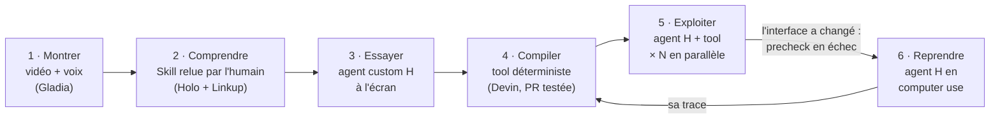
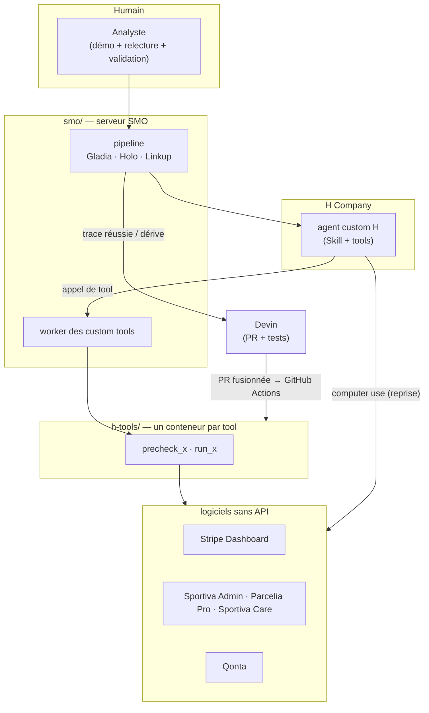

# Show me once

> **Vos équipes n'ont pas besoin d'apprendre à automatiser. Elles font la tâche une fois, l'agent fait les 500 suivantes.**

Hackathon H Company × 42AI — 7–8 novembre 2026.

**TL;DR (EN).** An ops analyst handles **one** Stripe chargeback while talking out loud. Show me once turns that recording
(Gladia + Holo) into an **H custom agent** with a reviewed **Skill**. The agent then defends the whole dispute queue in
parallel through the screen (Stripe Dashboard, back-office, carrier portal, support tool — none of them have an API).
**Devin** compiles each learned task into a deterministic **tool**; when the software UI changes, the tool's precheck fails,
the **H agent takes over in computer use**, and its trace sends Devin to repair the tool. Results are scored from the
**real dispute statuses in Stripe**, not from what the agent says.

---

## 1. Le problème

Une contestation de paiement (**chargeback**) non défendue avant la date limite, c'est de l'argent perdu d'office.
Une marketplace en reçoit des centaines par jour, à environ 15 minutes chacune.

Ce travail ne s'automatise pas par API :
- **les preuves sont dans des outils sans API** : back-office maison, portail du transporteur, outil de support ;
- **la décision dépend de règles que seule l'équipe connaît** : « moins de 15 €, on accepte », « carte volée confirmée, on accepte et on bloque le client »…

Les outils de contestation automatique existants ne voient que les données accessibles par API et appliquent *leurs* règles.

## 2. Notre réponse : apprendre en regardant, une fois



1. **Montrer.** L'analyste traite un litige en commentant à voix haute. Gladia transcrit (en direct, puis sur le fichier complet) ; une capture d'écran est extraite à chaque phrase.
2. **Comprendre.** Holo (Models API de H) relie chaque phrase à l'écran et en tire la procédure et **les règles implicites**. Linkup vérifie ces règles sur des sources publiques. L'humain relit et corrige la **Skill** avant tout lancement.
3. **Essayer.** Un **agent custom H** est créé avec cette Skill et refait la tâche seul, à l'écran. Holo juge si le résultat est le même que dans la démo ; sinon, la leçon est ajoutée à la Skill (3 essais au plus).
4. **Compiler.** Devin reçoit la trace réussie et écrit un **tool déterministe** (Playwright, sélecteurs par libellés visibles), son contrat d'interface et ses tests, dans une PR. Tests verts → fusion → déploiement automatique.
5. **Exploiter.** L'agent appelle le tool : rapide, reproductible, toujours arrêté avant l'action finale.
6. **Reprendre.** Si le logiciel a changé, le *precheck* du tool échoue : **l'agent H finit la tâche en computer use** avec la Skill, et sa trace renvoie Devin corriger le tool.

> Un script classique casse à la première mise à jour du logiciel. Le nôtre se répare : l'agent H prend le relais à l'écran, et Devin corrige le code derrière lui.

## 3. Pourquoi c'est solide

| Critère du jury | Ce que nous montrons |
|---|---|
| **Usage du computer use** | L'écran est central deux fois : pour **apprendre** (la démo) et pour **agir** là où il n'y a pas d'API, plus la reprise quand un tool casse. |
| **Fiabilité** | Le résultat est lu dans **Stripe** (statut réel de chaque litige), jamais dans le récit de l'agent. Chaque tâche est rejouée plusieurs fois (benchmark A/B). |
| **Utilité** | De l'argent récupéré, mesuré en euros. La même méthode marche pour n'importe quel back-office sans API. |
| **Originalité** | Apprentissage par démonstration + compilation en tool + **auto-réparation**. |
| **Contrôle par l'humain** | Skill relue avant lancement ; l'agent s'arrête toujours avant « Soumettre » ; bouton « Arrêter » ; aucun code de Devin n'est déployé sans tests verts. |

## 4. Démo et résultats

- **Vidéo de démo** : _lien à ajouter_
- **Écran « € récupérés »** : `chargebacks/` → `python -m som watch`

**Benchmark** — mêmes litiges, deux conditions (A : agent seul, prompt classique ; B : agent + Skill apprise de la démo).
Chaque litige traité ne se rejoue pas : chaque condition a son propre lot, créé à l'identique dans Stripe.

| | A — agent seul | B — agent + Skill |
|---|---|---|
| Litiges bien traités | _mesure en cours_ | _mesure en cours_ |
| € récupérés (statuts Stripe) | _mesure en cours_ | _mesure en cours_ |
| Contestés à tort | _mesure en cours_ | _mesure en cours_ |
| Fraudeurs bloqués | _mesure en cours_ | _mesure en cours_ |

Les chiffres sortent de `python -m som bench` (`runs/<date>/scores.csv`, lien de replay H de chaque session dans `log.csv`).

## 5. Organisation du repo

```
show-me-once/
├── smo/           la plateforme : capture → Skill → agent custom H → tool Devin → reprise    (serveur FastAPI, Railway)
├── h-tools/       l'usine à tools : un dossier par tâche apprise, écrit par Devin, un conteneur Railway par tool
├── chargebacks/   le cas d'usage : 60 litiges Stripe réels (mode test), outils internes Sportiva, notation, écran de démo
├── comptarex/     « Qonta », un faux logiciel comptable des années 2000 sans API : 2e terrain de test (factures)
└── prep/          préparation d'avant le samedi 10h30 : tests des API, journal de bord (aucun code produit)
```



Ce repo **rassemble les trois repos de travail de l'équipe**, importés avec tout leur historique : la chronologie des commits
pendant le hackathon reste lisible. Chaque dossier est **autonome** (ses dépendances, son `.env.example`, son README).
Les déploiements (Railway, GitHub Actions d'h-tools) tournent depuis les repos de travail ; celui-ci est la vue d'ensemble.

| Dossier | Repo de travail | Démarrer |
|---|---|---|
| [`smo/`](smo/) | `Jean-Christophe972/show-me-once` | [`smo/README.md`](smo/README.md) · plan détaillé : [`smo/PLAN.md`](smo/PLAN.md) |
| [`h-tools/`](h-tools/) | `Tomoroshimaru/h-tools` | [`h-tools/README.md`](h-tools/README.md) |
| [`chargebacks/`](chargebacks/) | `noahsgds/show-me-once` | [`chargebacks/README.md`](chargebacks/README.md) |
| [`comptarex/`](comptarex/) | `Jean-Christophe972/show-me-once` | [`comptarex/README.md`](comptarex/README.md) |
| [`prep/`](prep/) | `Jean-Christophe972/show-me-once` | [`prep/JOURNAL.md`](prep/JOURNAL.md) |

## 6. Partenaires : ce que chacun fait vraiment

| Partenaire | Rôle dans Show me once | Où |
|---|---|---|
| **H Company — Agents API** | agents custom, **Skills**, **custom tools** exécutés par notre serveur, vault (identifiants jamais dans un prompt), profils navigateur, sessions en parallèle | `smo/smo/clients/h.py`, `chargebacks/som/runner.py` |
| **H Company — Holo (Models API)** | lecture des captures de la démo, écriture de la procédure, juge des essais | `smo/smo/pipeline/understand.py`, `chargebacks/som/skill_builder.py` |
| **Gladia** | transcription en direct pendant l'enregistrement, puis horodatée sur le fichier complet | `smo/smo/clients/gladia.py`, `chargebacks/som/capture.py` |
| **Devin** | écrit et **répare** les tools (PR + tests), via l'API, avec la Skill `smo-tool` | `smo/smo/pipeline/compile.py`, `h-tools/` |
| **Linkup** | vérifie les règles dites par l'humain et cherche la documentation publique du logiciel | `smo/smo/pipeline/enrich.py` |
| **Stripe** | litiges réels en mode test ; leur statut final est notre vérité | `chargebacks/som/seed.py`, `chargebacks/som/checker.py` |

## 7. Sécurité

- Aucun secret dans le repo : chaque projet a son `.env.example`, les `.env` sont ignorés par git.
- Clés Stripe **de test uniquement** (le code refuse une clé live).
- Les identifiants des logiciels cibles sont lus dans le **vault H** à chaque appel, jamais écrits dans une consigne.
- Serveur SMO en ligne protégé par jeton obligatoire ; tools sans adresse publique utile sans ce jeton.
- Toutes les données sont fictives (marketplace « Sportiva », cabinet « Fiduciaire Moreau »).

## 8. Équipe

| | Rôle |
|---|---|
| Jean-Christophe Dorn | produit, cas d'usage, préparation, pitch |
| Thomas Alaphilippe | plateforme SMO, Qonta, h-tools |
| Noah Segonds | cas chargebacks, outils Sportiva, démo |
