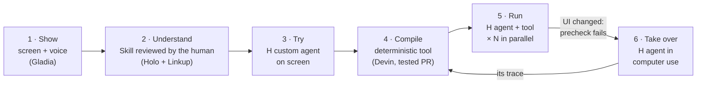
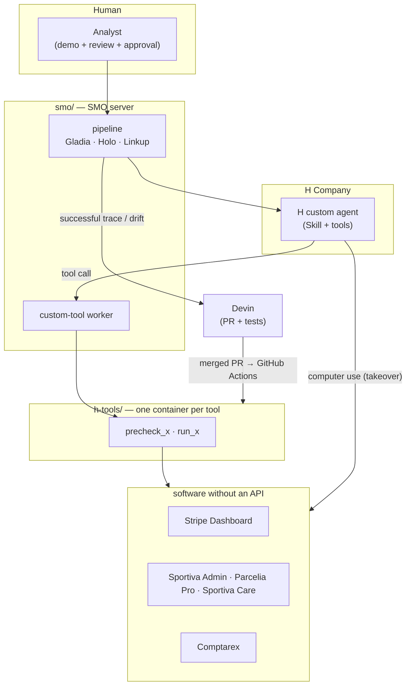

# Show me once

> **Until now, you learned from AI. With Show me once, you teach the AI.**

H Company × 42AI hackathon — November 7–8, 2026.

You do a task **once** on your screen while explaining it out loud — the way a manager shows an intern.
Show me once turns that recording into an **H custom agent** that works through the screen with **your rules**.
**Devin** then compiles the learned task into a fast, deterministic **tool**. When the software changes, the tool notices,
the **H agent takes over in computer use**, and Devin repairs the tool. **No technical skills needed** to create the agent.

Proof on a real case: **defending Stripe chargebacks**, scored from the real dispute statuses in Stripe — not from what the agent says.

---

## 1. The idea: show it once, like you would to an intern

When a manager trains an intern, they don't write a program. **They do the task in front of them and explain** what they
do and why: *"Here I check the amount. Under €15 we don't contest — it costs more than it brings back."*

Show me once does exactly that with an AI agent:
- **you do the task once**, on your screen, talking;
- Show me once builds **an agent that works on the screen like you do** (computer use), with **your rules**;
- **no technical skills**: no prompt to write, no workflow to draw, no code.

Computer-use agents already know how to use software. What they miss is **your way of doing it**: implicit rules,
exceptions, what you never do. That is exactly what a narrated demonstration contains.

## 2. How it works



1. **Show.** You do the task while talking. Gladia transcribes (live, then on the full file); one screenshot is extracted per sentence.
2. **Understand.** Holo (H Models API) links each sentence to the screen and extracts the procedure and **the implicit rules**. Linkup checks those rules against public sources. You review and edit the **Skill** before anything runs.
3. **Try.** An **H custom agent** is created with that Skill and redoes the task alone, on screen. Holo judges whether the result matches the demo; if not, the lesson is added to the Skill (3 attempts max).
4. **Compile.** Devin receives the successful trace and writes a **deterministic tool** (Playwright, selectors by visible labels), its UI contract and its tests, in a pull request. Green tests → merge → automatic deployment.
5. **Run.** The agent calls the tool: fast, reproducible, always stopping before the final action.
6. **Take over.** If the software changed, the tool's *precheck* fails: **the H agent finishes the task in computer use** with the Skill, and its trace sends Devin to repair the tool.

> A classic script breaks at the first software update. Ours repairs itself: the H agent takes over on screen, and Devin fixes the code behind it.

## 3. The case that proves it: defending chargebacks

A payment dispute (**chargeback**) not answered before its deadline is money lost by default.
A marketplace receives hundreds a day, at about 15 minutes each.

It is the ideal case for Show me once, because it cannot be automated through an API:
- **the evidence lives in tools without an API**: in-house back-office, carrier portal, support tool;
- **the decision depends on rules only the team knows**: *"under €15, accept"*, *"stolen card confirmed, accept and block the customer"*…

Existing auto-dispute tools only see data reachable through APIs and apply *their* rules.
Here, an analyst shows **one** dispute, and the agent defends the whole queue **with her rules**.

| Rule the analyst says out loud | Where the agent sees it | Decision |
|---|---|---|
| Amount under €15 | Stripe | accept (fees cost more) |
| Cardholder confirms the card was stolen | Sportiva Care (support) | accept **and block the customer** |
| Customer already refunded | Sportiva Admin (back-office) | contest, with the refund receipt |
| Delivered with signature | Parcelia Pro (carrier) | contest, with the proof of delivery |
| No signature, but customer wrote "received" | Sportiva Care | contest, with the ticket export |
| No evidence | — | accept |

## 4. Why it holds up

| Judging criterion | What we show |
|---|---|
| **Use of computer use** | The screen is central twice: to **learn** (the demo) and to **act** where there is no API — plus the takeover when a tool breaks. |
| **Reliability** | Results are read from **Stripe** (real status of each dispute), never from the agent's own report. Each task is replayed several times (A/B benchmark). |
| **Usefulness** | Any employee can create an agent without technical skills. On chargebacks: money recovered, measured in euros. |
| **Originality** | You don't write the agent, you **train** it: learning by demonstration, compiled into a tool, **self-repairing**. |
| **User control** | Skill reviewed before launch; the agent always stops before "Submit"; a "Stop" button; no Devin code is deployed without green tests. |

## 5. Demo and results

- **Demo video**: _link to add_
- **"€ recovered" screen**: in `chargebacks/`, `python -m som watch`

**Benchmark** — same disputes, two conditions (A: agent alone, classic prompt; B: agent + Skill learned from the demo).
A handled dispute cannot be replayed, so each condition gets its own identical batch created in Stripe.

| | A — agent alone | B — agent + Skill |
|---|---|---|
| Disputes handled correctly | _being measured_ | _being measured_ |
| € recovered (Stripe statuses) | _being measured_ | _being measured_ |
| Wrongly contested | _being measured_ | _being measured_ |
| Fraudsters blocked | _being measured_ | _being measured_ |

Numbers come from `python -m som bench` (`runs/<date>/scores.csv`; the H replay link of every session is in `log.csv`).

## 6. Tests

| Project | Command | Result |
|---|---|---|
| `smo/` | `cd smo && uv sync && uv run pytest` | **53 passed**, 1 skipped (the live test needs a running Comptarex) |
| `h-tools/` | `cd h-tools && uv sync && uv run pytest tests` | **16 passed** |
| First tool written by Devin | `h-tools/tools/saisir_une_facture_fournisseur_web/` | green in GitHub Actions before merge |

The offline tests run without any API key.

## 7. Repository layout

```
show-me-once-hackathon-h/
├── smo/           the platform: capture → Skill → H custom agent → Devin tool → takeover    (FastAPI server, Railway)
├── h-tools/       the tool factory: one folder per learned task, written by Devin, one Railway container per tool
├── chargebacks/   the use case: 60 real Stripe disputes (test mode), Sportiva internal tools, scoring, demo screen
├── comptarex/     Comptarex, a fake 2000s accounting software with no API: second test ground (supplier invoices)
└── prep/          preparation done before Saturday 10:30: API tests and logbook (no product code)
```



This repository **brings together the team's three working repositories**, imported with their full history: the commit
timeline during the hackathon stays readable. Each folder is **self-contained** (its own dependencies, `.env.example` and README).
Deployments (Railway, h-tools GitHub Actions) run from the working repositories; this one is the overview.

| Folder | Working repository | Start here |
|---|---|---|
| [`smo/`](smo/) | `Jean-Christophe972/show-me-once` | [`smo/README.md`](smo/README.md) · full plan: [`smo/PLAN.md`](smo/PLAN.md) |
| [`h-tools/`](h-tools/) | `Tomoroshimaru/h-tools` | [`h-tools/README.md`](h-tools/README.md) |
| [`chargebacks/`](chargebacks/) | `noahsgds/show-me-once` | [`chargebacks/README.md`](chargebacks/README.md) |
| [`comptarex/`](comptarex/) | `Jean-Christophe972/show-me-once` | [`comptarex/README.md`](comptarex/README.md) |
| [`prep/`](prep/) | `Jean-Christophe972/show-me-once` | [`prep/JOURNAL.md`](prep/JOURNAL.md) |

The detailed READMEs inside each folder are written in French.

## 8. Names used in this project

| Name | What it is |
|---|---|
| **Show me once** | the product |
| **SMO** | the platform code (`smo/`): server, pipeline, recording page |
| **som** | the Python package of the chargebacks use case (`chargebacks/som/`) |
| **Skill** | the written procedure + rules the agent follows (an H Skill), learned from the demo and reviewed by the human |
| **Tool** | a deterministic script written by Devin for one learned task, exposed to the agent as two H custom tools: `precheck_<task>` and `run_<task>` |
| **Precheck** | checks, without changing anything, that the software screens still match the tool's UI contract |
| **Takeover** | when a tool fails, the H agent finishes the task in computer use and reports the drift |
| **Comptarex** | fake accounting software (no API), our second test ground — called *Qonta* in some internal docs |
| **Sportiva / Parcelia** | fictional marketplace and carrier used in the chargebacks case |

## 9. Partners: what each one actually does

| Partner | Role in Show me once | Where |
|---|---|---|
| **H Company — Agents API** | custom agents, **Skills**, **custom tools** executed by our server, vault (credentials never in a prompt), browser profiles, parallel sessions | `smo/smo/clients/h.py`, `chargebacks/som/runner.py` |
| **H Company — Holo (Models API)** | reads the demo screenshots, writes the procedure, judges the trials | `smo/smo/pipeline/understand.py`, `chargebacks/som/skill_builder.py` |
| **Gladia** | live transcription while recording, then timestamped transcription of the full file | `smo/smo/clients/gladia.py`, `chargebacks/som/capture.py` |
| **Devin** | writes and **repairs** tools (PR + tests) through its API, following the `smo-tool` Skill | `smo/smo/pipeline/compile.py`, `h-tools/` |
| **Linkup** | checks the rules stated by the human and finds the software's public documentation | `smo/smo/pipeline/enrich.py` |
| **Stripe** | real disputes in test mode; their final status is our ground truth | `chargebacks/som/seed.py`, `chargebacks/som/checker.py` |

## 10. Security

- No secrets in the repository: every project has a `.env.example`, `.env` files are git-ignored.
- Stripe **test keys only** (the code rejects a live key).
- Target-software credentials are read from the **H vault** on every call, never written in an instruction.
- The online SMO server requires a token; tools only answer requests carrying it.
- All data is fictional (the "Sportiva" marketplace, the "Fiduciaire Moreau" accounting firm).
