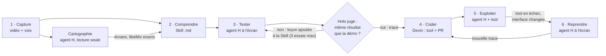
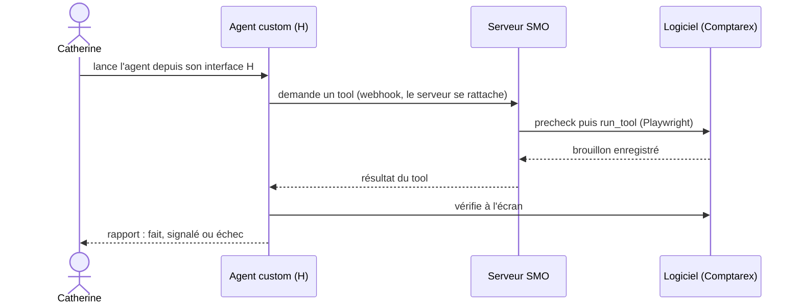

# Plan SMO : capturer, automatiser et maintenir des agents H

> **Problème.** Capturer, automatiser et maintenir des agents H pour des tâches répétitives.
> **Réponse.** Une capture vidéo + voix (Gladia), Holo et Devin créent et maintiennent des tools custom, utilisés par des agents custom de H.
> **Exemple.** Catherine, à la compta, ne connaît rien à l'automatisation. Elle fait sa tâche une fois en vidéo, en commentant à voix haute. Elle obtient un agent custom dans son interface H, avec sa Skill, son tool et la reprise en computer use si le tool casse.

## Le parcours (vision validée le 7 nov.)



| # | Étape | Qui | Ce qui en sort |
|---|---|---|---|
| 1 | Capture | Humain + Gladia | ce qui est dit, horodaté, plus une capture d'écran par phrase |
| 2 | Comprendre | Holo (Models API) + agent H | étapes et règles implicites, en Skill .md relisible ; en parallèle, un agent H cartographie les écrans de la tâche en lecture seule (chemin, libellés exacts), carte gardée par logiciel et par tâche |
| 3 | Tester | Agent custom H + Holo | l'agent essaie seul en computer use ; Holo compare son écran final à la fin de la démo ; si c'est raté, la leçon entre dans la Skill et un nouvel essai repart de zéro (3 au plus) |
| 4 | Coder | Devin | tool déterministe, contrat d'interface, tests et Skill corrigée, dans une PR |
| 5 | Exploiter | Agent H + tool | precheck, tool, puis contrôle du résultat réel dans le logiciel |
| 6 | Reprendre | Agent H → Devin | il finit à l'écran, et sa trace renvoie Devin corriger le tool et la Skill |

Qui exécute le tool quand Catherine lance son agent depuis H :



Les mêmes étapes, telles que les enchaîne `uv run smo` :

```
1. Capture          vidéo + voix (1 fois)
2. Mise en forme    transcribe (Gladia) · frames (ffmpeg) · understand (LLM : Holo, Models API) · enrich (Linkup, option)
                    → une info digeste (procedure.json) + skill.md                                 [review : relecture, --auto pour sauter]
3. Test par Holo    provision : l'agent custom est créé dans SON H avec la Skill, sans tool
                    trial     : il traite la pièce de la démo en computer use → trace + ce qui est réellement enregistré
4. Devin code       compile   : trace + Skill + captures → tool déterministe + contrat d'interface + tests + skill.md → PR
5. Tool ajouté      upgrade   : PR fusionnée → l'agent reçoit son tool (et la Skill du repo) pour ses prochains runs
6. Reprise          en exploitation, tool en échec / imprévu / interface changée → l'agent finit en computer use
7. Maintenance      la trace de la reprise repart chez Devin → PR qui corrige tool ET Skill → upgrade
```

- **Pourquoi un LLM et pas Devin à l'étape 2** : Holo (Models API) lit les captures, répond en quelques secondes et a été testé en préparation. Une session Devin prend plusieurs minutes et coûte à chaque fois, on le garde pour le code.
- **Pourquoi l'agent de Catherine fait lui-même le test (étape 3)** : elle a son vrai agent dès le début, et la trace que reçoit Devin vient de l'agent qui utilisera le tool.
- Option `--guided` : si la Skill seule ne suffit pas, l'agent est guidé phrase par phrase par ce que l'humain a dit.

**À l'exécution** (Catherine lance son agent depuis H) :
1. L'agent appelle `precheck_<tâche>`, qui vérifie que l'interface n'a pas changé, sans rien modifier.
2. Si le precheck est OK, il lit la pièce et appelle `run_<tâche>` : saisie déterministe, arrêt en brouillon, idempotente, règles codées en dur.
3. Sinon, ou si le tool échoue, il fait la saisie en computer use avec la Skill, puis appelle `report_drift`. Sa session repart chez Devin (`SMO_AUTO_REPAIR=1`, ou `smo repair`), qui ouvre une PR corrigeant le tool et `skill.md`.
4. Après la fusion, `smo run <id> --only upgrade --force` repousse le tool et la Skill dans H.
5. Il vérifie toujours avec `verify_entry` (on ne croit jamais l'agent sur parole) et peut vérifier un fournisseur avec `check_supplier` (Linkup).

**Qui exécute les tools ?** Chez H, un custom tool est exécuté par le programme qui suit la session. C'est le **serveur SMO** (Railway) :
- il est prévenu par un webhook H (`session.status_updated` → `awaiting_tool_results`) ;
- il interroge aussi H toutes les 5 s en secours ;
- il se rattache alors à la session (`client.session(id).stream(tools=...)`), même si elle a été lancée depuis l'interface H.

Le SDK le prévoit explicitement : « for calls another process answers ».

## Ce que les API permettent (vérifié dans le SDK `hai-agents` 1.4.3 et les docs, le 7 nov.)

| Besoin | Comment | État |
|---|---|---|
| Agent custom par API | `client.agents.create_agent(name, environments, instructions, skills, tools, answer_format, model)` + révisions | ✅ SDK |
| Skill par API | `client.skills.create_skill(name, description, body)` + révisions | ✅ SDK |
| Guider l'agent en direct (option `--guided`) | `start_session` + `send_message` + `stream` | ✅ SDK |
| Trace d'une session | events (`policy_event.tool_reqs`, `observation_event` : URL, titre, texte, capture) | ✅ SDK · ⚠️ contenu exact des actions à voir : `smo doctor --probe guided` |
| Tools exécutés par notre serveur | `awaiting_tool_results` + webhook ou `list_sessions(status=...)` + `stream(tools=...)` | ✅ SDK · à prouver : `smo doctor --probe tool` |
| Site en localhost | navigateur `host: "user_device"` | ✅ SDK |
| Connexion sans mot de passe dans la consigne | vaults H (`fill_secret_at`, TOTP), browser profiles | ✅ docs · pas encore branché |
| Devin par API | `POST /v3/organizations/{org}/sessions`, statut et `pull_requests[].pr_url` par polling | ✅ docs · ⚠️ accès API selon le plan (Teams/Max) |
| Linkup | `search` (structured), `fetch` ; ne voit pas les pages connectées | ✅ docs |

## Ce qui reste à faire (dans l'ordre)

1. **Clés dans `smo/.env`**, puis `uv run smo doctor` : tout doit être ✅ ou ⏭️.
2. **Les 2 tests qui valident le plan** : `uv run smo doctor --probe guided tool` (une à deux sessions H).
3. ~~Site compta~~ ✅ **Comptarex** tourne en local (http://127.0.0.1:8042) et `SITE_*` est rempli dans `smo/.env`.
   `doctor` est ✅ et le precheck réel v1/v2 est vérifié (`tests/test_site_live.py`).
   Reste à décider l'accès en ligne pour le navigateur cloud H : tunnel ou Railway. En attendant, le navigateur tourne sur cette machine (`host: "user_device"`).
4. **Page d'enregistrement** ✅ (`uv run smo serve` → http://localhost:8000) : écran + voix dans Chrome, transcription Gladia en direct, suivi, relecture de la Skill, liens vers l'agent et la PR. Charte H (couleurs et polices relevées sur hcompany.ai), sans logo.
   **1re capture réelle** : INV-001 sur le site, voix + écran, puis `uv run smo new capture.mov --task "Saisir une facture fournisseur" --owner catherine --sample INV-001 --go`.
5. **Serveur SMO sur Railway** (Dockerfile prêt) :
   - variables d'environnement = `.env` ;
   - `uv run smo webhook` → `H_WEBHOOK_SECRET` ;
   - Secrets Devin `SITE_*`.
6. **Démo de réparation** : passer le site en v2 (`POST /api/admin/ui-version`), relancer l'agent, puis montrer le precheck en échec, la reprise en computer use et la PR Devin.
7. **Benchmark** (10 factures × 3 runs) :
   - A : agent seul ;
   - B : agent + Skill ;
   - C : agent + tool ;
   - on mesure réussite, temps, coût et écart entre runs ;
   - le contrôle se fait par `GET /api/invoices`, comparé à `prep/factures/verite_terrain.csv`.
8. **Desktop** (prototype) : Comptarex a aussi une vraie application Qt (`uv run --extra desktop comptarex-desktop`), sur la même base.
   - L'agent H la pilote avec l'environnement `desktop` (extra `hai-agents[desktop]`, déjà installé).
   - Le script compilé passe par l'API d'accessibilité macOS, en Python, pas en Rust.
   - `/api/invoices` voit aussi les saisies faites dans l'application.

## Risques connus

- **Durée d'une session Devin** (non documentée, souvent plus de 10 min selon mon estimation) : la v1 se génère en avance, la réparation se montre en accéléré.
- **Holo4** renvoie une erreur 402 sans crédits. `holo3-1-35b-a3b` suffit pour `understand`, mais l'agent custom utilise par défaut `holo4-27b` (`SMO_AGENT_MODEL` pour changer).
- **Identifiants du site** dans la consigne du trial (et du replay guidé) : acceptable pour un compte de test, à remplacer par un vault H.
- **`understand` convertit les PDF avec `sips`** (macOS) : le pipeline tourne sur un Mac. Le serveur Railway, lui, n'en a pas besoin.
